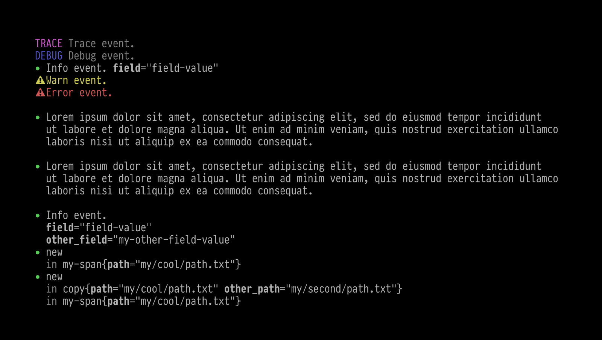

# tracing-human-layer

<a href="https://docs.rs/tracing-human-layer/latest/tracing_human_layer/"></a>
<a href="https://crates.io/crates/tracing-human-layer"></a>

A human-friendly and colorful terminal output
[`tracing_subscriber::Layer`][tracing_subscriber::Layer] for
[`tracing`][tracing].

Features:

- Line-wrapping ([optional][textwrap-options])
- Colorful output ([customizable][styles] and [optional][disable-color])
- Blank lines between long log messages
- One-line format for short log messages with one short field



## Quick start

```rust
use tracing_subscriber::layer::SubscriberExt;
use tracing_subscriber::util::SubscriberInitExt;
use tracing_human_layer::HumanLayer;

tracing_subscriber::registry()
  .with(HumanLayer::new())
  .init();
```

## Performance

TL;DR: Half of the cost of logging is writing to stderr.

I haven't done too much performance work on `tracing-human-layer`, but I do
have a couple benchmarks. It seems to take 1.92-6.17µs to format an event
(including emitting a span and event), with the exact cost depending on
whether or not color output ([`HumanLayer::with_color_output`][disable-color])
or text wrapping ([`HumanLayer::with_textwrap_options`][textwrap-options]) is enabled.

Formatting an event _and writing it to stderr_ takes 12.55µs, so actually
showing the logs to the user is about 2× slower than just formatting them.

[tracing_subscriber::Layer]: https://docs.rs/tracing-subscriber/latest/tracing_subscriber/layer/trait.Layer.html
[tracing]: https://docs.rs/tracing/latest/tracing/
[textwrap-options]: https://docs.rs/tracing-human-layer/latest/tracing_human_layer/struct.HumanLayer.html#method.with_textwrap_options "line-wrapping can be disabled or customized"
[styles]: https://docs.rs/tracing-human-layer/latest/tracing_human_layer/struct.HumanLayer.html#method.with_style_provider "output colors can be customized"
[disable-color]: https://docs.rs/tracing-human-layer/latest/tracing_human_layer/struct.HumanLayer.html#method.with_color_output "output colors can be disabled"
